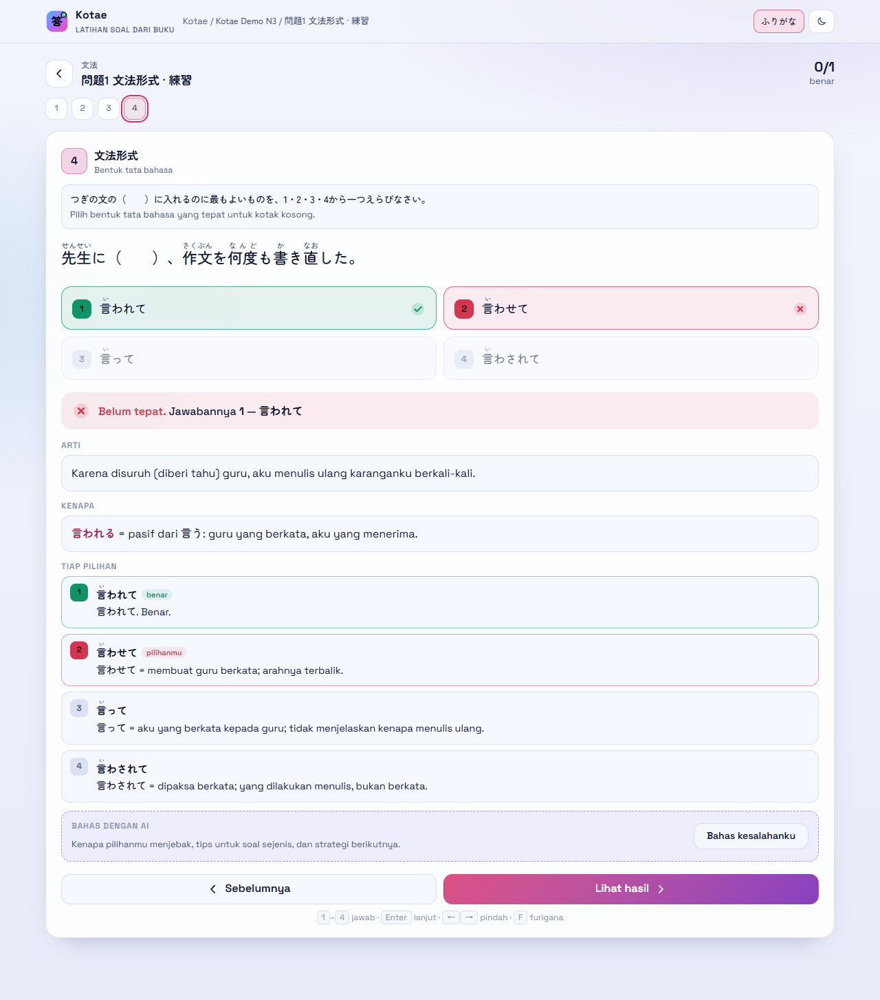
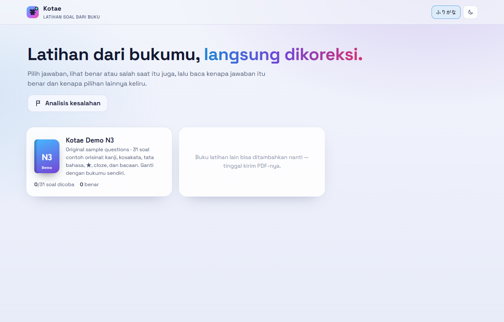
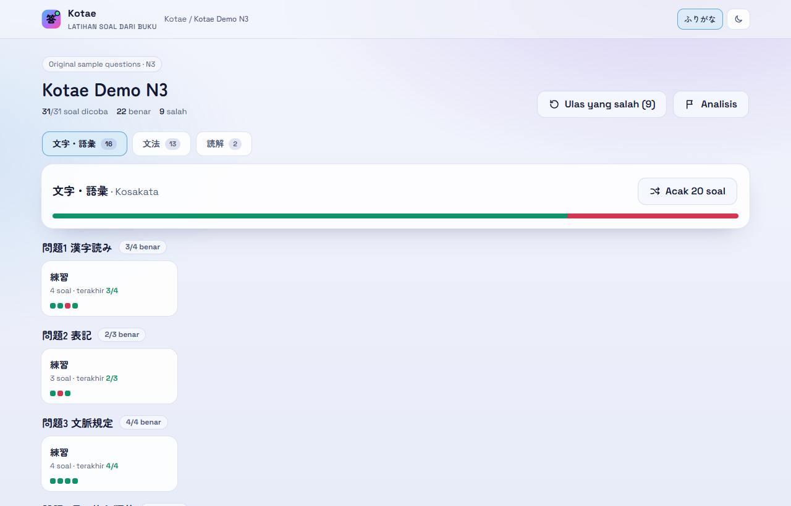
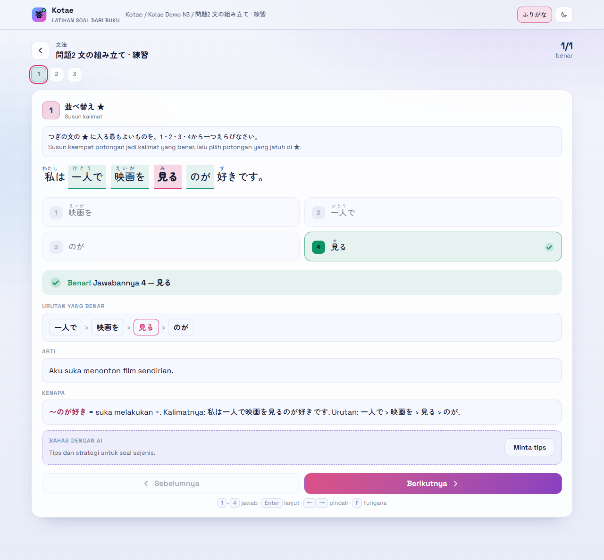
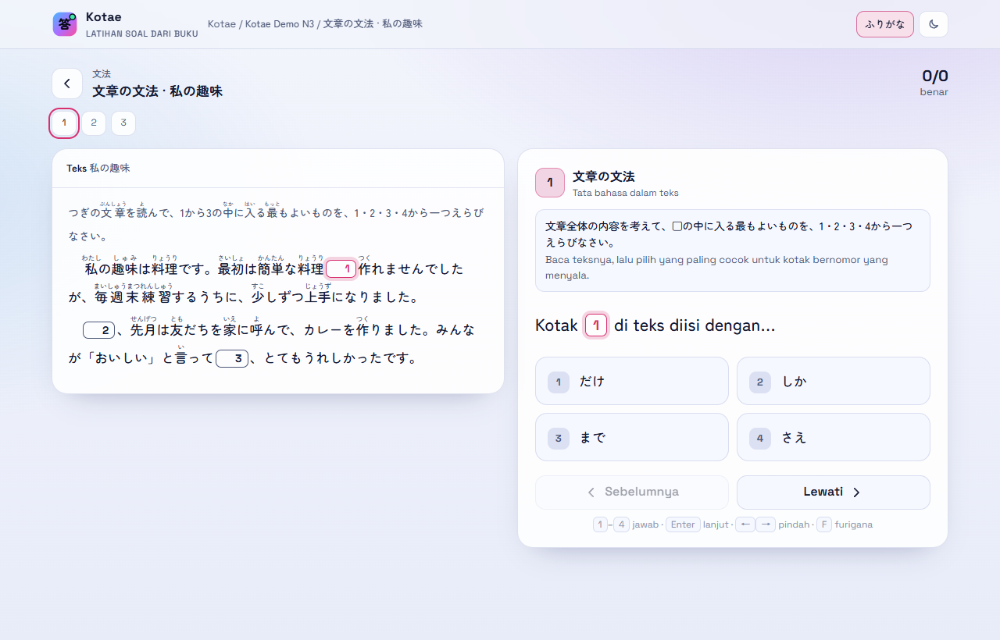
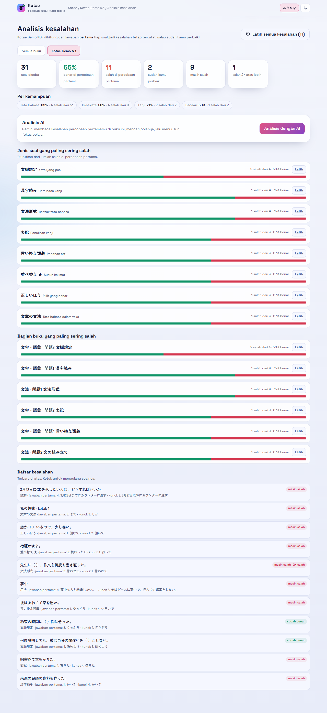
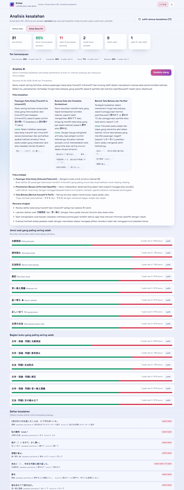
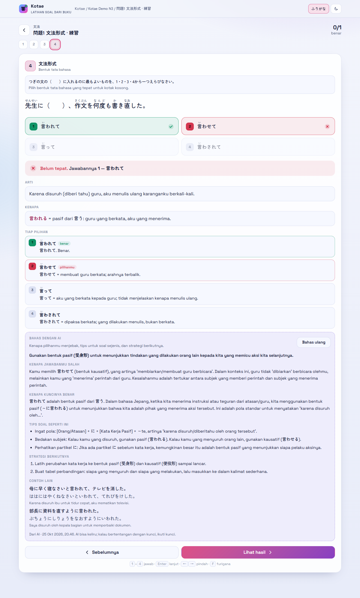
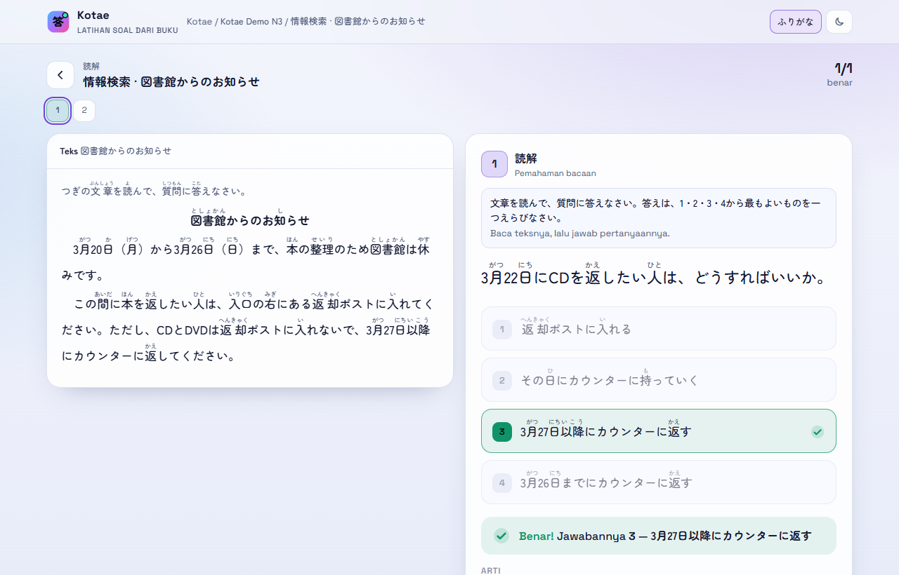
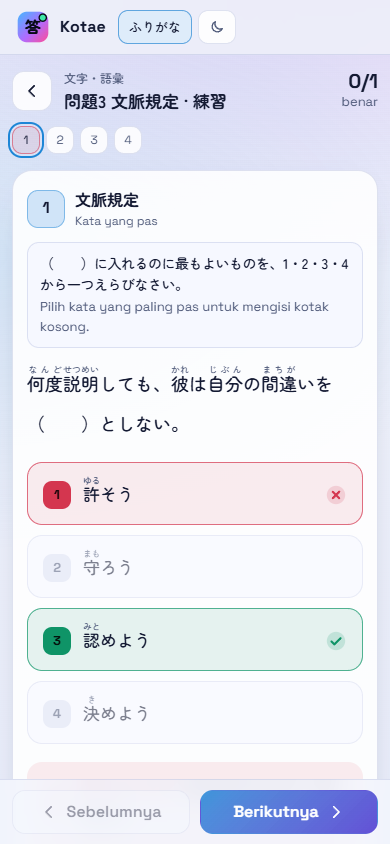

# Kotae 答え — practice questions from your own books

Kotae turns the practice books you own into an interactive quiz: pick an answer, see right or wrong instantly,
then read **why the key is right and why every other option is wrong**. Your mistakes are tracked, analysed,
and (optionally) explained further by AI.

It was built for JLPT (Japanese) books, but it works with any multiple-choice question book. See
[Beyond JLPT](#beyond-jlpt).

**No books are included.** Book content belongs to its publisher, so this repo ships only the app, the import
tools, and a small demo book written from scratch. You import your own books with the help of an AI coding
assistant ([how](#import-your-own-book-with-ai)). Imported books stay on your computer.



## Features

- **Instant correction** with an explanation for every option, a translation, and the reason the key is right.
- **Japanese-friendly**: furigana (toggle with `F`), underlined targets, ★ sentence-ordering questions, cloze
  passages with numbered boxes, reading passages, listening questions with audio, pictures.
- **Your book's structure**: sections → parts → sets, page numbers, a progress strip per set,
  "review the ones I got wrong", and a random 20-question mix.
- **Mistake analysis**: based on your **first** answer to each question, so a mistake stays on record even after
  you get it right on a retry. Accuracy per skill, the question types and book parts you miss most (each with a
  *Practise* button), and a list of every mistake.
- **AI, only when you click** (optional, Gemini): one button analyses all your mistakes and returns patterns,
  focus areas, and a short plan. Another button on each answered question explains why your pick was a trap,
  gives tips for this kind of question, a next-step strategy, and extra example sentences. Answers are cached,
  so reopening a question never calls the AI again.
- **One HTML file**: no server, no build step, no account. Progress lives in your browser (`localStorage`).
  Light and dark themes; works on phones.

| | |
|---|---|
|  |  |
|  |  |
|  |  |
|  |  |

<p align="center"></p>

## Quick start

```bash
git clone https://github.com/musmeong/kotae.git
```

Open `kotae/index.html` in Chrome, Edge or Firefox (double-click is enough). The demo book has 31 original
questions covering every main question type. The interface is in Indonesian.

## Import your own book with AI

You need the book as a PDF (a scan is fine) and an AI coding assistant that can read files and run Python, for
example [Claude Code](https://claude.com/claude-code), OpenAI Codex, or Cursor.

1. Open this folder in the assistant.
2. Ask it, for example:

   > Import my book `C:\Books\My JLPT N3 Workbook.pdf` into Kotae. Follow docs/IMPORTING.md.

3. The assistant reads [`AGENTS.md`](AGENTS.md) / [`CLAUDE.md`](CLAUDE.md) and
   [`docs/IMPORTING.md`](docs/IMPORTING.md). It then:
   - plans the tabs, parts and sets with you,
   - transcribes the questions into simple text files (`tools/src/<book>/`),
   - writes an explanation for every option,
   - types the book's answer key separately and audits every answer against it,
   - builds `data/<book>.js` and registers the book in `data/books.js`,
   - clicks through every question in the app before calling it done.
4. Reload `index.html`. Your book is there.

Big books take a while, because every question gets its own explanation. Ask for one part first, check it, then
continue. If the book has audio (CDs, MP3s), give the assistant those files as well; they are used as they are.

The text formats are documented in [`docs/IMPORTING.md`](docs/IMPORTING.md), so you can also write or fix files
by hand:

```text
@v1-1 kanji p12
Q: {駅|えき}の[改札]で{友|とも}だちを{待|ま}っている。
O: かいざつ | かいさつ | がいさつ | かいさく
A: 2
T: I am waiting for a friend at the station ticket gate.
W: **改札（かいさつ）** = ticket gate. 札 is read さつ, unvoiced.
1: かいざつ — さつ is not voiced.
2: かいさつ. Benar.
...
```

```bash
python tools/transcribe2json.py my-book   # text files -> tools/my-book.extracted.json
python tools/build.py my-book             # + explanations -> data/my-book.js
python tools/audit.py my-book             # every answer vs the separately typed answer key
```

## Turn on the AI features (optional)

1. Get a Gemini API key at [Google AI Studio](https://aistudio.google.com/apikey).
2. Copy `local/gemini-keys.example.js` to `local/gemini-keys.js` and paste your key(s). You can add several keys;
   when one hits its rate limit the next one is used.
3. Reload. The **Analisis dengan AI** button (mistake analysis page) and **Bahas kesalahanku / Minta tips**
   (under each answered question) become active.

- `local/gemini-keys.js` is git-ignored. Never commit it.
- The AI is called **only when you click**. Answering questions never sends anything.
- When you click, the question text, options, answer key, your answer and the existing explanation are sent to
  Google's Gemini API. It works from `file://` too; no server is needed.
- The default model is `gemini-3.1-flash-lite`. Change `model` in the same file if you like.

## Beyond JLPT

Kotae's engine is generic: a question is a stem, 2+ options, a key, and explanations. So:

| Works | Notes |
|---|---|
| Any multiple-choice book (biology, history, law, IT certifications…) | Define your question types in `book.json` (`tag`, short name, instruction line). |
| Pictures and diagrams | `img=` on a question, or `IMG:` lines inside a passage. Crop them from the book at full resolution. |
| Reading passages and case studies | One passage shared by several questions; it stays visible beside them. |
| Audio | `audio=` per question (listening tests, language books). |

Current limits:

- The interface text is Indonesian, and some labels are JLPT-flavoured (the furigana button, built-in Japanese
  question types). It is a single HTML file, so translating it is straightforward.
- The AI prompts are written for a JLPT N3 tutor. For another subject, edit `AI_SYSTEM` and `AIQ_SYSTEM` in
  `index.html`.
- No formula rendering (LaTeX). Math works with plain text or Unicode (x², √, ≤); put complex formulas in
  pictures.
- Multiple choice and ordering only. No free-text or numeric answers.

## Project layout

```text
index.html                 the whole app (HTML + CSS + JS)
data/books.js              the list of books shown on the home page
data/demo-n3.js            the demo book (generated)
local/                     your Gemini keys (gemini-keys.js, git-ignored)
tools/transcribe2json.py   text files -> structured questions
tools/build.py             merge explanations -> data/<book>.js
tools/audit.py             check answers, explanations and "Benar." markers
tools/src/demo-n3/         the demo book source: a format example
docs/IMPORTING.md          step-by-step import guide (for AI assistants and humans)
```

`.gitignore` keeps every imported book (`data/*`, `tools/src/*`, keys, extracted files) out of git; only the
demo is tracked. If you fork this repo, keep it that way.

## Copyright

Use Kotae only with books you own, for your own study. Don't publish imported books (questions, scans, audio,
covers). The demo book in this repo was written from scratch for Kotae.

## License

[MIT](LICENSE) for the code and the demo book.

---

## Ringkasan (Bahasa Indonesia)

Kotae mengubah buku latihan soal milikmu menjadi kuis interaktif: pilih jawaban, langsung tahu benar atau salah,
lalu baca kenapa jawabannya benar dan kenapa pilihan lainnya salah. Ada analisis kesalahan (dihitung dari jawaban
pertama, jadi kesalahan tetap tercatat walau sudah diperbaiki) dan bantuan AI Gemini yang **hanya jalan saat
diklik**.

**Isi buku tidak disertakan** karena hak ciptanya milik penerbit. Repo ini hanya berisi app, alat impor, dan buku
demo orisinal. Untuk memasukkan bukumu sendiri, buka folder ini di asisten AI (Claude Code, Codex, Cursor) lalu
minta: *"Import buku `<path PDF>` ke Kotae, ikuti docs/IMPORTING.md."* Buku hasil impor tetap di komputermu
dan tidak ikut ter-commit.

Cara pakai: clone repo ini, lalu buka `index.html` (klik dua kali). Untuk fitur AI, salin
`local/gemini-keys.example.js` menjadi `local/gemini-keys.js` dan isi key Gemini-mu.

Selain buku JLPT, Kotae bisa dipakai untuk buku soal pilihan ganda lain (biologi dengan gambar, sejarah,
sertifikasi, dll.). Batasannya: tampilan berbahasa Indonesia, prompt AI disetel untuk JLPT, belum ada tampilan
rumus matematika (pakai teks biasa atau gambar), dan belum ada soal isian.
